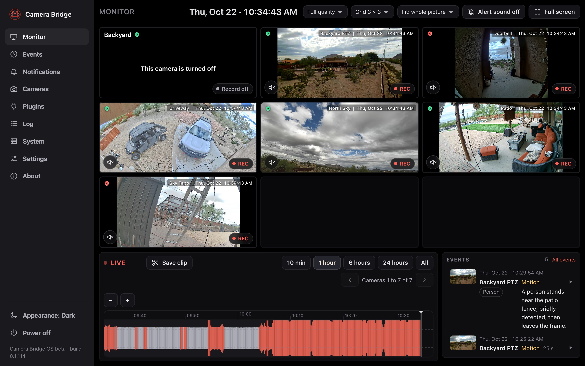
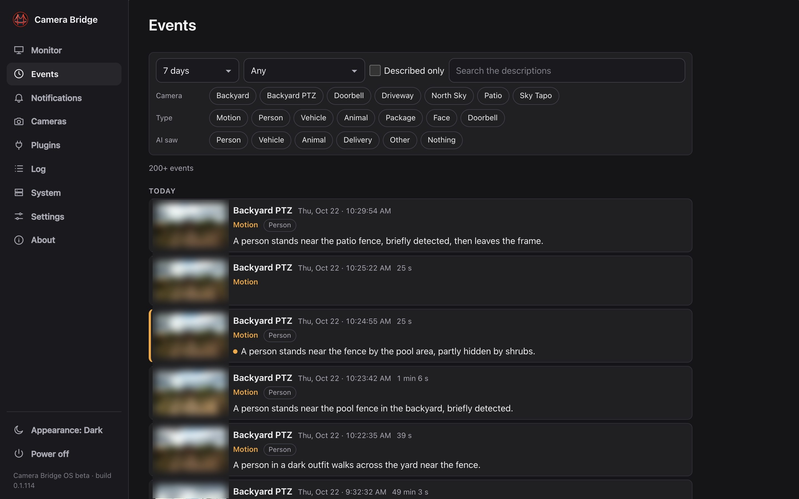
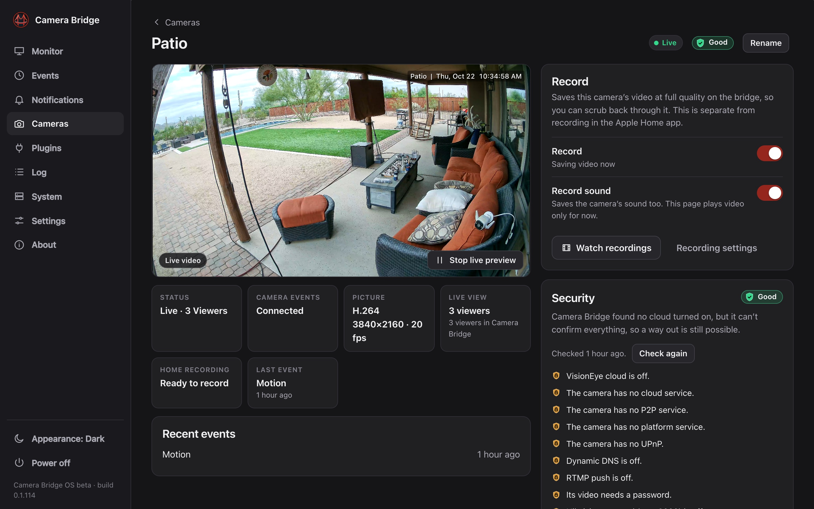
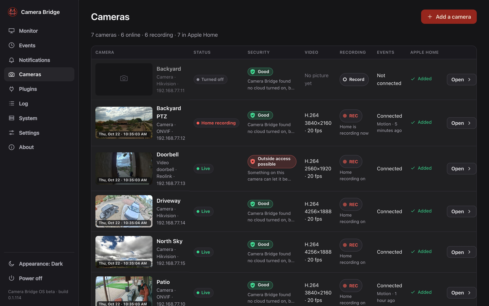
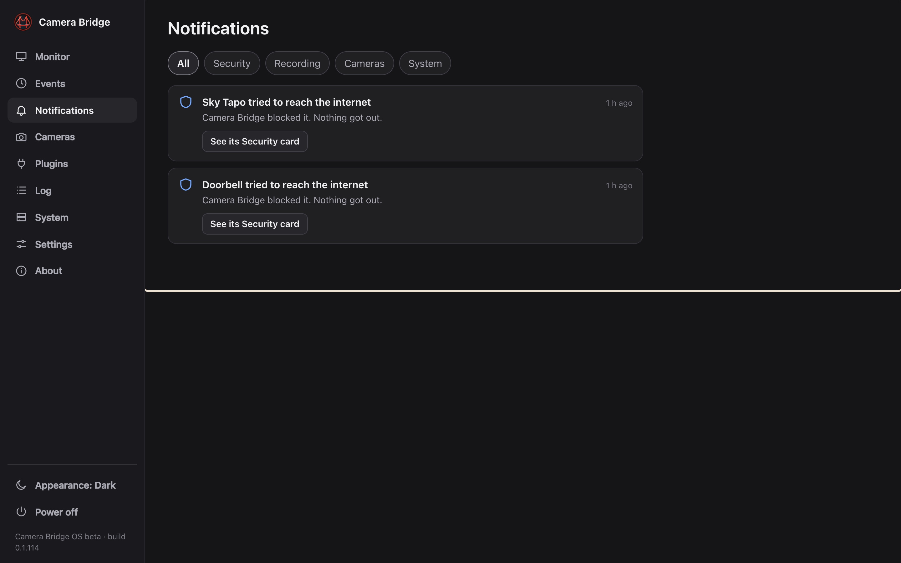
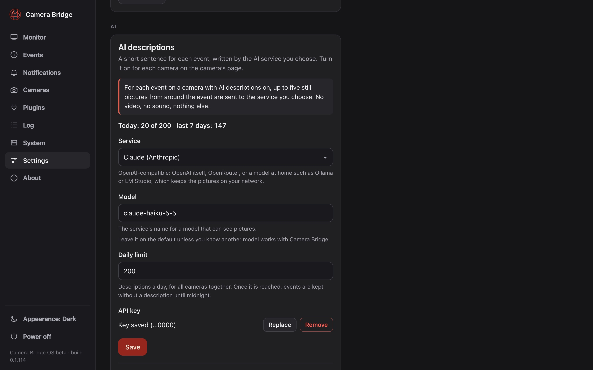
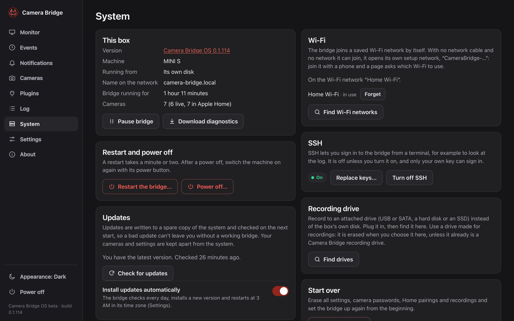

<p align="center"></p>

# Camera Bridge OS

**The friendly NVR for the cameras you already own.**

Camera Bridge OS turns a small Intel mini PC into a network video recorder that is easy to use and pleasant to look at:
- It records your cameras around the clock.
- It shows them all live on one page, above one timeline.
- It puts every event in one list, each with a picture and an optional one-line AI description such as "A delivery driver
  leaves a package at the front door".
- It keeps your cameras off the internet.
- If you want, it also brings each camera into the Apple Home app with HomeKit Secure Video. You don't need Apple Home to use it.

It runs at home, with no cloud account, no subscription and no hub to buy. The name is the idea: it bridges your cameras to
your screens and, if you like, to your smart home. You set it all up from a browser at
`http://camera-bridge.local`, and it needs no keyboard or screen.

<p align="center"></p>

Camera Bridge is **free for personal and noncommercial use**, and the source is available here. Commercial use needs a
license: see [License](#license).

Website: <https://www.camera-bridge.app> · Documentation: <https://docs.camera-bridge.app>

> **Beta.** Releases are tagged `os-v*` on [GitHub Releases](https://github.com/coalsi/camera-bridge/releases). Versions before
> 1.0 are betas (pre-releases) while the interface is refined. They run every day on the reference box below, and a box on a
> beta updates itself to the next one.

## What it does

### A real NVR
- **Records around the clock** to the box's SSD or a drive you attach. Each camera has a Record switch, with limits on how
  long and how much to keep. Recordings keep the camera's own video, not a re-encoded copy.
- **Monitor:** every camera live on one wall, with sound and real live video over a single connection. Below it is one timeline
  for all cameras: scrub back hours, play in slow motion (¼×, ½×), at 1×, fast (2×, 4×, 8×) or as a time-lapse (30× to 300×), and
  step picture by picture while paused.
- **Saved clips** as MP4 with sound, labelled with the camera's name and the time, from one camera or several at once: drag the red
  range on the timeline, or save it as a sped-up time-lapse.
- **One label everywhere:** the camera's name and the date and time look the same on the Monitor, in Apple Home and in saved
  clips. The bridge keeps every camera's clock on its time zone.

### An AI assistant for your events (optional)
- **Events page:** every camera's events in one list, newest first. Each event has a picture from the recording, its type
  (motion, person, vehicle, animal, package, face, doorbell) and the AI's sentence. Click one to play it from just before it
  began.
- **AI descriptions:** with your own key for Claude or any OpenAI-compatible service, each event gets a short sentence, what it
  saw (person, vehicle, animal, delivery…) and how much it matters (routine, unusual, alarm). Alarm and unusual events stand
  out, and you can filter by any of it or search the sentences. A model on your own network (Ollama, LM Studio) keeps even
  that at home.
- **Off by default, and small:** only up to five small still pictures per event are sent, only for cameras you switch on, with a
  daily limit you set. A description usually arrives about 8 seconds after the motion starts.

### Private and secure by design
- **Internet guard:** the box points each camera's DNS at itself. It sees every name the camera tries to reach and blocks the
  internet ones, so a camera stays local without changing your router. Each camera's Security card lists what it tried and
  that it was blocked, and a camera never loses points for being blocked.
- **Camera setup in one step:** for each camera it turns off the maker's cloud, P2P and UPnP, sets strong video settings,
  sets the camera's clock and time zone, and points its DNS at the bridge. It shows every change first and can put everything
  back.
- **Secure address:** every box gets a trusted `https://<random name>.box.camera-bridge.app` address with a real certificate
  (Let's Encrypt, renewed by the box itself). It works in every browser at home with nothing to install. Only the name and a
  home address go through camera-bridge.app; video and the page never leave your network. The plain
  `http://camera-bridge.local` sends browsers there, and a switch in Settings › System turns that off.
- No telemetry and no account. The only things that leave the box are update checks, the time server, and (only if you turn
  them on) AI descriptions.

### Apple Home, if you want it
Camera Bridge OS is a complete NVR on its own. Apple Home is optional: pair a camera with the Home app only if you want it there.
- Every camera becomes its own Home accessory with **HomeKit Secure Video**, live view, snapshots, two-way audio where the
  camera has it, and doorbells that ring like HomeKit doorbells.
- Motion, person, vehicle, animal and package events become Home notifications and recording triggers. They come from the
  camera itself (ONVIF events and makers' own interfaces) or from the box's built-in motion detection.
- A camera you turn off stays in Home, with a "Camera off" picture, so your rooms and automations keep working.
- **Google Home:** planned, not available yet.

### Easy to live with
- **Notifications** appear in the corner of the page and fade away, once per thing that happened, on every device. The
  Notifications page keeps them all.
- **Straighten the picture** for panorama cameras whose horizon bends. It applies everywhere the camera is seen, and recordings
  keep the original.
- Finds ONVIF cameras on your network and joins Wi-Fi by itself (or opens a setup hotspot for your phone). It installs itself to
  the PC's internal disk and updates itself from signed releases, with automatic rollback if a new version doesn't start.

## Screenshots

Taken on a real box with real cameras (more, with what each shows, in [docs/screenshots/os](docs/screenshots/os)).

| | |
|---|---|
| <br>**Events:** every camera's events with pictures, AI descriptions and filters | <br>**A camera:** live preview, status, recording and security |
| <br>**Cameras:** status, security, video and Apple Home at a glance | <br>**Notifications:** everything worth knowing, kept in one place |
| <br>**AI descriptions:** your own key, your choice of service, a daily limit | <br>**System:** updates, Wi-Fi, recording drive and SSH |

## Minimum requirements

Camera Bridge OS is tuned for its reference box, a **Beelink Mini S (Intel N150, 12 GB, 512 GB SSD)**, which records five
cameras around the clock at about a quarter of its processor. That box is the minimum.

| | Minimum | More headroom |
|---|---|---|
| Processor | Intel N150 or N100 (4 cores) with its Intel graphics (VA-API) | Intel N305 or Core i3 |
| Memory | 12 GB | 16 GB |
| Storage | 512 GB internal SSD | 1 TB SSD, or a recording drive you attach |
| Network | Gigabit Ethernet or Wi-Fi | Gigabit Ethernet |
| Cameras | up to 12 recording, all live on the Monitor | 16 or more |

You also need:

- A USB stick (16 GB or more) to install from, and UEFI boot with Secure Boot off.
- Cameras that offer an RTSP stream or ONVIF Profile S or T, on the same network.
- For HomeKit Secure Video: an Apple **home hub** (Apple TV 4K or HomePod, on current software) and an **iCloud+** plan.
  Live view in Home works without iCloud+.

Details, storage advice and BIOS settings: [docs/linux/HARDWARE.md](docs/linux/HARDWARE.md).

## Install

1. Download `camera-bridge-os-<version>-amd64.img.xz` from the newest `os-v*` release and write it to a USB stick with
   balenaEtcher.
2. Start the mini PC from the stick. An Ethernet cable works with no setup; without one, join the box's own
   `CameraBridge-…` Wi-Fi with a phone and pick your network.
3. Open `http://camera-bridge.local`, set a password, and install the system to the PC's internal disk from the System
   page. Remove the stick and restart.
4. Add your cameras (the page finds ONVIF cameras on its own) and turn on Record for each one you want recorded. To put a
   camera in Apple Home too, scan its code in the Home app.

The full guide is [docs/linux/USER-GUIDE.md](docs/linux/USER-GUIDE.md); the design is
[docs/linux/ARCHITECTURE.md](docs/linux/ARCHITECTURE.md).

## Supported cameras

Camera Bridge supports cameras by the standards they speak, not by brand:

| Standard | What is used |
|---|---|
| **RTSP** | Any camera with an RTSP stream: H.264 or H.265 video, AAC or G.711 audio, over TCP, with Basic or Digest authentication. |
| **ONVIF** (Profile S and T) | Discovery on the local network, stream addresses, device settings, event subscriptions (motion and smart detections), two-way audio. |
| **Manufacturer event interfaces** | Several camera families have their own local HTTP interface for events and settings, which Camera Bridge uses when it finds one. |
| **Webhook** | Anything that can make an HTTP request (Frigate, Home Assistant, a script) can trigger motion on a camera. |

The list of cameras people have set up successfully is on the website: <https://www.camera-bridge.app/cameras>.
If yours is missing or misbehaves, open a [camera support request](https://github.com/coalsi/camera-bridge/issues/new?template=camera_support_request.yml).
Camera Bridge accessories are not certified by Apple: the Home app asks you to tap *Add Anyway* when you add one.

## Camera Bridge for Mac

A new Camera Bridge for Mac is coming soon. For now, Camera Bridge OS (beta) is the way to run Camera Bridge.

If you have the earlier Mac app, copies that are already installed keep working and get no new versions for now. To move
your cameras over, use *Move to Camera Bridge OS* in that app, then import them on the box. Its source is kept in
[Archive/mac-app](Archive/mac-app).

## Build from source

Camera Bridge OS: the image is built with mkosi from `linux/os` (`linux/os/build.sh`, normally by GitHub Actions on an
`os-v*` tag), and the daemon is the `camerabridged` product of the engine package, built with Swift 6.4 on Linux. See
[docs/linux/BUILDING.md](docs/linux/BUILDING.md).

The engine tests run on a Mac with Xcode 27 (Swift 6.4), and on Linux in a container (`sh Tools/linux-test.sh`):

```sh
# The engine (portable Swift package) and its tests
cd Packages/CameraBridgeKit
swift test

# The web interface's tests (Node; no install)
cd ../..
sh linux/web-tests/run.sh
```

The archived Mac app is built from its own folder; see [Archive/mac-app/README.md](Archive/mac-app/README.md).

Layout:

| Path | What |
|---|---|
| `Packages/CameraBridgeKit` | The engine: HomeKit Accessory Protocol server, HomeKit Secure Video, RTSP/RTP, camera drivers, media pipeline. Portable Swift; Apple frameworks only in `PlatformApple`. |
| `linux` | Camera Bridge OS: the image (`linux/os`), the web interface (`linux/web`) and their tests and tools. |
| `Archive/mac-app` | The archived macOS app (SwiftUI), its Xcode project and release tools. CI does not build it. |
| `Tools` | Test and capture scripts, brand asset scripts, the go2rtc fetch script, `cbctl`. |
| `Interop` | Node-based test oracles (dev only, never shipped). |
| `docs` | Integration guides, interop notes, third-party notices and the engine contract changes. |

## Support the project

Camera Bridge is made by one person and is free for everyone at home. If it saves you a store-bought NVR or a cloud camera plan, you
can [sponsor it on GitHub](https://github.com/sponsors/coalsi) or [support it on Ko-fi](https://ko-fi.com/coreysilvia). You can also help by starring the repository, reporting a
camera that works (or doesn't) with a [camera support request](https://github.com/coalsi/camera-bridge/issues/new?template=camera_support_request.yml),
and sending pull requests.

## License

Camera Bridge is **free for personal and noncommercial use**. It is licensed under the
[PolyForm Noncommercial License 1.0.0](LICENSE): use it at home, for hobby projects, study, research, and inside
charities, schools, public bodies and similar organizations. **Commercial use requires a license**: installers,
integrators, businesses, products and services built on it, and resale. See [COMMERCIAL.md](COMMERCIAL.md) or write to
<legal@camera-bridge.app>.

This is a *source-available* license, not an OSI "open source" license. Third-party components keep their own licenses:
see [NOTICE](NOTICE) and [THIRD_PARTY_LICENSES.md](THIRD_PARTY_LICENSES.md).

## Contributing

Bug reports, camera reports and pull requests are welcome. Contributions require signing the
[Contributor License Agreement](CLA.md) once; see [CONTRIBUTING.md](CONTRIBUTING.md). Please follow the
[Code of Conduct](CODE_OF_CONDUCT.md). Security issues: see [SECURITY.md](SECURITY.md).

## Trademarks

Apple, the Apple logo, Apple Home, HomeKit, HomePod, Apple TV, iCloud and macOS are trademarks of Apple Inc., registered
in the U.S. and other countries. "Works with Apple Home" and similar marks belong to Apple. Camera Bridge is an independent
project and is not affiliated with, endorsed by or sponsored by Apple Inc. Camera Bridge accessories are not certified
under Apple's MFi Program. All other names are the property of their owners and are used only to describe compatibility.
